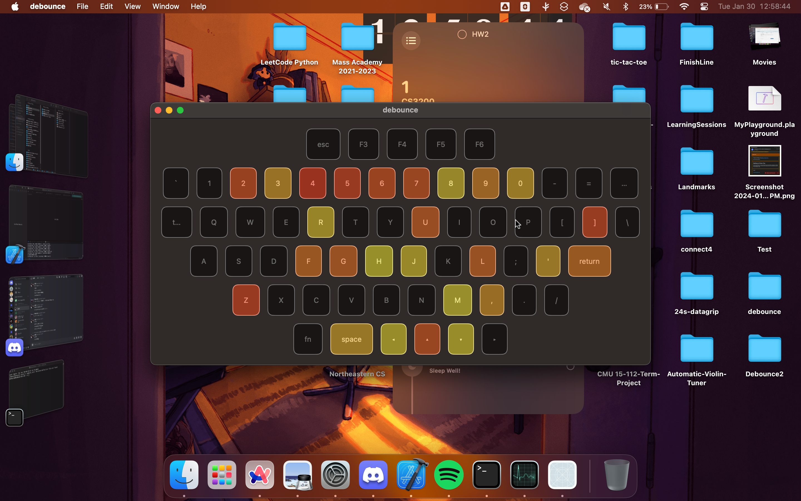

# Keyboard Double-Press Blocker

A MacOS menu bar application that prevents unintended double-typing caused by malfunctioning keyboards. Built with Swift, SwiftUI, and SQLite to provide a seamless typing experience with intelligent keystroke filtering.

## Features

- **Real-time Double-Press Prevention**: Intercepts and blocks unintended duplicate keystrokes using customizable debounce timing
- **Menu Bar Integration**: Lightweight menu bar app that runs unobtrusively in the background
- **Customizable Debounce Time**: User-configurable timing to match different keyboard sensitivities and typing styles
- **Keypress Analytics**: SQLite-powered tracking and storage of keystroke patterns
- **Visual Heat Map**: SwiftUI-based heat map visualization to identify problematic keys and typing patterns
- **Low-Level System Integration**: Uses CoreGraphics for efficient, system-level keystroke interception

## Screenshots

